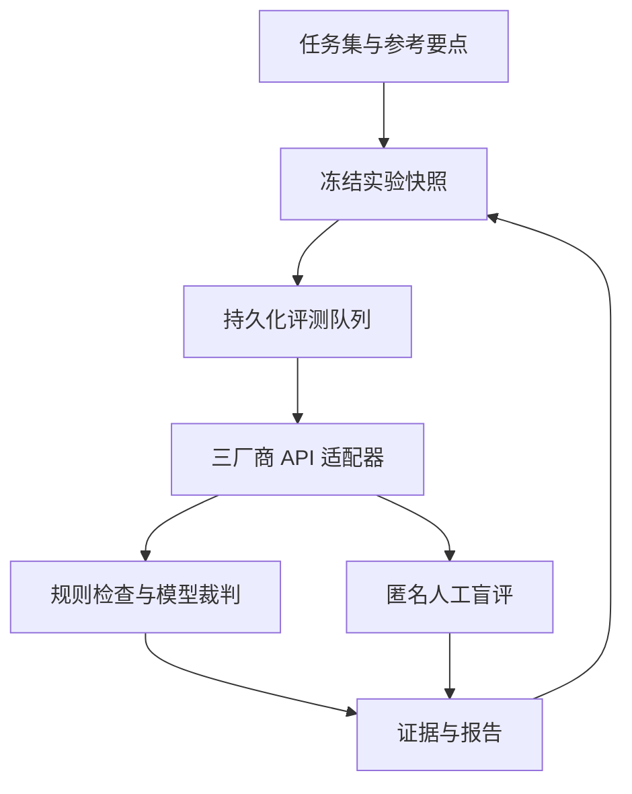

# 课衡 LessonBench

面向教育内容的大模型评测中台。包含原创 Query / Benchmark、多厂商任务队列、规则机评、可选跨厂商模型裁判、独立 A/B 盲评页、交互课件隔离预览和可追溯报告。

**交付状态：平台 Demo 可运行；内置 72 条人工编写的演示样例与一组四模型真实 API 评测。真实实验为 4 道精简题 × 4 个模型通道，16 条生成成功，14 条裁判评分有效；另 2 条裁判返回空内容。所有调用来自第三方 OriginCoder，模型身份由平台标识，不能独立核验。小样本不宜用于生产选型或厂商排名。**

## 本地运行

需要 Node.js 24 LTS。提供跨平台 Node 启动脚本；当前验收环境为 Linux，Windows / macOS 尚未实测。

```bash
npx pnpm@11.25.0 install --frozen-lockfile
npm run setup:local
npm run dev
```

打开 `http://localhost:5173`。独立盲评页面为 `http://localhost:5173/review`。首次访问管理首页会幂等写入 24 条基础任务、8 条扩展任务、4 条低预算实测任务，以及演示和真实实验。数据保存在 `.wrangler/state`，刷新与重启不会丢失；删除该目录才会清空本地数据。

`setup:local` 完成生产构建并按序应用数据库迁移，不调用任何模型。默认只绑定本机。在线公开模式无需登录：每个浏览器通过随机 HttpOnly Cookie 获得独立工作区，只能访问自己的配置、任务与实验；使用“分享盲评”或“分享报告”分别生成独立的访问链接。清除 Cookie 会失去工作区访问能力。该机制适合合成数据的 Demo，并非企业级账号认证，不应放入真实学生敏感信息。

## 已完成的真实评测与复现

1. 在“模型接入”选择对应平台，填写 API Key 和 Model ID，先测试连接。OriginCoder 分组可能需要不同 Key；测试会产生一次请求。
2. 保存模型配置。Key 只保存在页面内存，不写入浏览器本地存储或数据库；刷新或进入独立盲评页后需重新填写。
3. “新建评测”选择“真实评测”，按需选择所需题目，并选择至少三种模型来源。默认 temperature=0.3、max_tokens=4096；各模型是否支持温度及推理模式不同，报告保留实际请求参数。
4. 按需启用跨厂商模型裁判。24 题全量为 72 次生成之外最多 72 次计划裁判调用；32 题全量为 96 次生成之外最多 96 次计划裁判调用；网络/限流重试可能增加调用数。先小规模验证，再跑全量。
5. 页面保持打开时自动调度。可暂停、继续和取消未执行任务；在途请求会完成并保留记录。刷新后点击“继续调度”。
6. 在“人工盲评”分别完成评分、偏好与理由。建议至少两名学科教师独立标注。浏览器会话计数不代表已验证的真实人员。
7. 导出 Markdown 报告、CSV 和完整 JSON；“打印 / PDF”生成 PDF。

服务端长期配置可复制 `.dev.vars.example` 为 `.dev.vars`，仅在该文件中填写密钥。不要提交真实密钥。`.dev.vars` 只用于本地；在线部署应使用平台的 Secret 配置。

| 厂商 | 默认模型 | 环境变量 | 标准 API Base URL |
|---|---|---|---|
| DeepSeek | deepseek-flash | DEEPSEEK_API_KEY | https://api.deepseek.com |
| 阿里云百炼 | qwen-plus | DASHSCOPE_API_KEY | https://dashscope.aliyuncs.com/compatible-mode/v1 |
| 智谱 | glm-4.7 | ZAI_API_KEY | https://open.bigmodel.cn/api/paas/v4 |
| OpenAI | gpt-6-luna | OPENAI_API_KEY | https://api.openai.com/v1 |

当前 OpenAI 接入使用标准 API Key；当前对话不能直接当作批量调用 API。某些符合条件的开源/本地应用可经额外授权使用 ChatGPT 计划，本项目尚未实现该方式。阿里密钥须与地域匹配，智谱标准 API Key 与 Coding Plan Key 不应混用。B.AI 的 DeepSeek 和 GLM 预设请求 low 推理，Qwen 推理行为以平台为准；模型、参数支持与价格会变化，请先测试连接。

## B.AI 低成本接入

在“模型接入”点击“使用 B.AI 预设”，输入一个 B.AI Key 后可读取账户可用模型列表，再分别测试连接。候选模型为 `DeepSeek-V4.1-Flash`、`qwen3.8-flash`、`glm-5.3-flashx`；实际 ID、可用性、费用以 B.AI 账户与用量页面为准。B.AI 是一家聚合接口服务，报告需区分模型开发来源和实际 API 提供者。GLM-5.3-FlashX 不支持关闭思考；不同模型的推理和温度参数可能不同，不应描述为严格同一推理配置。平台发票、余额和大陆网络连通性未验证。CLI 可在本地使用 `BAI_API_KEY`。

## OriginCoder 聚合接口

点击“使用 OriginCoder 预设”，为 DeepSeek、OpenAI、Grok 和 Claude 分别填写其账户分组密钥，保存配置后测试。默认 ID 为 `deepseek-v4.1-flash`、`gpt-6.1-sol`、`grok-4.7`、`claude-sonnet-4-6`，实际可用性以账户和接口为准。该接口是第三方代理，模型名称由平台声明，不能独立验证最终模型身份；不同模型分组可能需要不同 Key。每次请求最多尝试一次，以减少重复计费。其请求不发送 temperature，接口参数和模型版本可能不同，不构成严格同参对比。价格与账单以平台实际信息为准。

本地 CLI 可分别使用 `ORIGINCODER_DEEPSEEK_API_KEY`、`ORIGINCODER_OPENAI_API_KEY`、`ORIGINCODER_XAI_API_KEY`、`ORIGINCODER_ANTHROPIC_API_KEY`；密钥不应写进源码或提交到 GitHub。

## 硅基流动低成本接入

在“模型接入”点击“使用硅基流动预设”，填写一个该平台 API Key（同步到 DeepSeek、Qwen、GLM 三个模型通道），保存配置后分别测试。默认使用 `deepseek-ai/DeepSeek-V3.2`、`Qwen/Qwen3.5-4B` 与 `THUDM/GLM-4-9B-0414`。它们由一个推理平台托管，模型开发来源不同；可用性、免费额度和价格以平台实际页面为准，当前未真实连通测试。切换预设会清除页面中的密钥。CLI 可使用 `SILICONFLOW_API_KEY`。

## 无人值守 CLI

启动本地服务后，在第二个终端执行：

```bash
# 不需要密钥，自动跑完整演示并导出报告
npm run eval -- --url http://localhost:5173

# 全量真实实验；密钥从环境变量或服务端读取
npm run eval -- --url http://localhost:5173 --live --judge --max-calls 210

# 可选 OpenAI + 两家其他模型；费用取决于真实平台账单
npm run eval -- --url http://localhost:5173 --live --providers deepseek,qwen,openai --limit 3 --max-calls 9

# 先跑3道题、三家厂商，无模型裁判
npm run eval -- --url http://localhost:5173 --live --limit 3 --max-calls 9

# 接续已有演示实验，不重新创建
npm run eval -- --url http://localhost:5173 --run <run-id>

# 接续真实实验；--live 允许从当前终端环境读取厂商密钥
npm run eval -- --url http://localhost:5173 --run <run-id> --live
```

`--max-calls` 限制计划生成与裁判调用数，不是金额预算，也不包含重试。CLI 默认不打印密钥或模型原始回答。结果默认写到 `outputs/evaluation/`。公开站点通过浏览器 Cookie 隔离工作区，当前 CLI 不持久化该 Cookie；无人值守请使用本地服务。终端中断可用 `--run` 继续；超时租约会标记为结果未知，不自动重复计费。

## Benchmark 与评分

内置 24 条原创基础合成任务：教案、课件脚本、习题、作业反馈各 6 条，基础、进阶、挑战各 8 条；另有 8 条扩展题，每类各 2 条，涵盖项目学习、苏格拉底式追问、凸透镜焦点和实验诚信。任务覆盖数学、语文、英语、科学、物理、历史、信息科技；包括实验安全、隐私、提示注入、证据不足等边界情境。完整文件：`docs/Benchmark.json` 与 `docs/Benchmark_Extension.json`。基础演示实验仍固定在原 24 题。四条额外精简实测题及其结果快照位于 `lib/eval/public-real-eval.json`。

- Query 定义学段、情境、约束和统一 JSON 输出协议。
- 参考要点来自任务设计，不是经过教师标定的权威金标；正式选型前需复核。
- 规则集为 `edu-rubric-v1.1`，旧实验保留原有版本；规则分：JSON 15、结构/时长 25、目标/分层 15、检测题/解析 20、知识点提及 15、安全说明/手机号扫描 10。
- 关键词只检查“提及”，不证明知识正确。安全说明存在不代表语义安全。启发式答疑题对部分直接条件或完整答案表达增加零权重提示，不能覆盖所有答案泄露形式，必须人工复核。
- 模型裁判与人工共用五维 Rubric：准确性30%、教学25%、指令20%、表达15%、安全10%。每项1–5分，加权映射到0–100。
- 模型裁判先给证据、再评分；输入作为不可信数据封装；不让生成厂商自评。但不同生成厂商使用不同裁判，仍有裁判异质性。
- 失败调用不按零分计入内容均值；截断单独标注，不进入裁判均值；缺失指标不编造。

## 交互课件检查

“课件检查”提供自编的凸透镜正常与故意缺陷样例，在仅允许脚本的隔离 iframe 中手动操作。编辑或导入 HTML 后可更新预览，并查看六项简单的静态文本线索。它不执行自动化轨迹测试、视觉模型评估或模型打分，不能证明课件安全或教学正确；浏览器隔离不是执行不受信任内容的完整安全边界。

## 盲评与统计

`/review` 独立加载，不请求管理看板。盲评接口只返回题目、参考要点、匿名A/B内容和随机分配ID，不返回模型名、响应ID、耗时、分数或内部答案ID。A/B顺序由服务端随机；同一会话同一组合只允许提交一次。评审后不揭晓身份。

报告分开显示规则合规、模型裁判、人工偏好。人工胜率分母为胜+负，平局与双差另列。规则全通过率与人工胜率提供Wilson 95%区间，仅作小样本描述。机人一致率只计算人工明确选A/B、双方裁判有效且分数不同的组合；没有有效样本时为空。样本来自相同题目，正式统计需要按Query聚类或配对bootstrap，不能把所有投票当独立观测。

当前盲评基于浏览器会话去重。创建者可将仅授权匿名盲评的链接发给评审者；只读报告使用另一链接，可查看聚合结果和模型来源。链接持有者可以转发链接；这不是企业级身份与角色权限管理。

## 架构

React 19 + TypeScript / Vinext 前端与 API 路由；Cloudflare Worker 服务端；D1 SQLite + Drizzle 迁移。数据表包括 cases、runs、results、reviews、settings。自定义 CSS，响应式布局。



服务端原子领取任务并设置租约，防止并发重复领取；每次调度最多3条，OriginCoder 请求90秒超时且最多尝试1次；其他渠道45秒超时，对限流/网络/5xx最多尝试2次。评测保存参数、题目快照、SHA-256、实际模型名、响应ID、usage、finish_reason和错误类型。配置改动不影响历史实验快照。

费用由操作者填写CNY/百万Token单价、缓存价格和日期。缺失价格、usage、存在失败或重试计费不确定时显示未知。平台不伪造发票；从实际付费供应商账号申请账单与发票。

## 自有服务器部署

仓库提供 Node 24 + SQLite 生产运行方式及 `Dockerfile`、`compose.yaml`、`Caddyfile`。Node 构建和 SQLite 会话隔离已在 Linux 本地测试；Docker 构建、实际域名和中国大陆网络尚未验证。

```bash
npx pnpm@11.25.0 install --frozen-lockfile
npm run build:server
LESSONBENCH_PUBLIC_MODE=1 LESSONBENCH_DB_FILE=/var/lib/lessonbench/lessonbench.sqlite npm run start:server
```

生产环境应通过 HTTPS 反向代理，不要将输入 API Key 的页面直接暴露在明文 HTTP。Docker Compose 可在设置 `SITE_DOMAIN` 并将域名解析至服务器后使用 `docker compose up -d --build`；中国大陆服务器面向公众提供网站前需按适用规定完成域名备案。数据保存在 Docker 卷 `lessonbench_data`，应自行备份。容器没有内置共享 API Key，访客使用自己的 Key。

## 验证

```bash
npm run typecheck
npm test
npm run build
npm run demo:report
# 先 build，再验证公开模式会话和分享隔离
npm run test:anonymous
# 先 build:server，再验证 Node + SQLite 模式
npm run test:server
# 本机运行 dev 后，可执行HTTP集成测试；仅允许本地URL
LESSONBENCH_URL=http://localhost:5173 npm run test:integration
```

Windows PowerShell 设置变量：`$env:LESSONBENCH_URL='http://localhost:5173'` 后运行 `npm run test:integration`。

自动测试覆盖评分边界、格式/时间约束、SSRF地址限制、价格缺失、厂商参数、鉴权错误及截断；HTTP集成脚本覆盖队列竞争、幂等创建、匿名返回、重复提交、报告与状态转换。实际验证状态见 `docs/Validation.md`，不能把提供了测试脚本当作该脚本已执行通过。

## 文件说明

- `app/`：管理界面、独立盲评页与HTTP API。
- `lib/eval/`：任务、厂商适配、规则、裁判、队列、统计和报告。
- `db/`、`drizzle/`：数据库定义与迁移。
- `scripts/evaluate.mjs`：无人值守评测驱动。
- `docs/evidence/`：明确标注的演示评分与完整样例。
- `docs/Workflow.md`：评测流程、演示顺序与真实实验补齐要求。
- `docs/Interview_Submission.md`：可直接用于提交和答辩的项目说明。

## 参考资料

- EduEval cognitive framework: https://arxiv.org/abs/2512.00290
- CJEval educational task design: https://arxiv.org/abs/2409.16202
- MiniAppBench interactive evaluation: https://arxiv.org/abs/2603.09652
- ArtifactsBench visual-interactive evaluation: https://arxiv.org/abs/2507.04952
- B.AI API: https://docs.b.ai/zh-Hans/llmservice/api/
- 硅基流动 API: https://docs.siliconflow.cn/
- OpenAI API 模型: https://developers.openai.com/api/docs/models/gpt-6-luna
- DeepSeek API: https://api-docs.deepseek.com/
- Qwen Chat API: https://help.aliyun.com/zh/model-studio/qwen-api-via-openai-chat-completions
- GLM OpenAI兼容: https://docs.bigmodel.cn/cn/guide/develop/openai/introduction
- Zheng et al. (2023). Judging LLM-as-a-Judge with MT-Bench and Chatbot Arena. https://arxiv.org/abs/2306.05685
- Wang et al. (2023). Large Language Models are not Fair Evaluators. https://arxiv.org/abs/2305.17926
